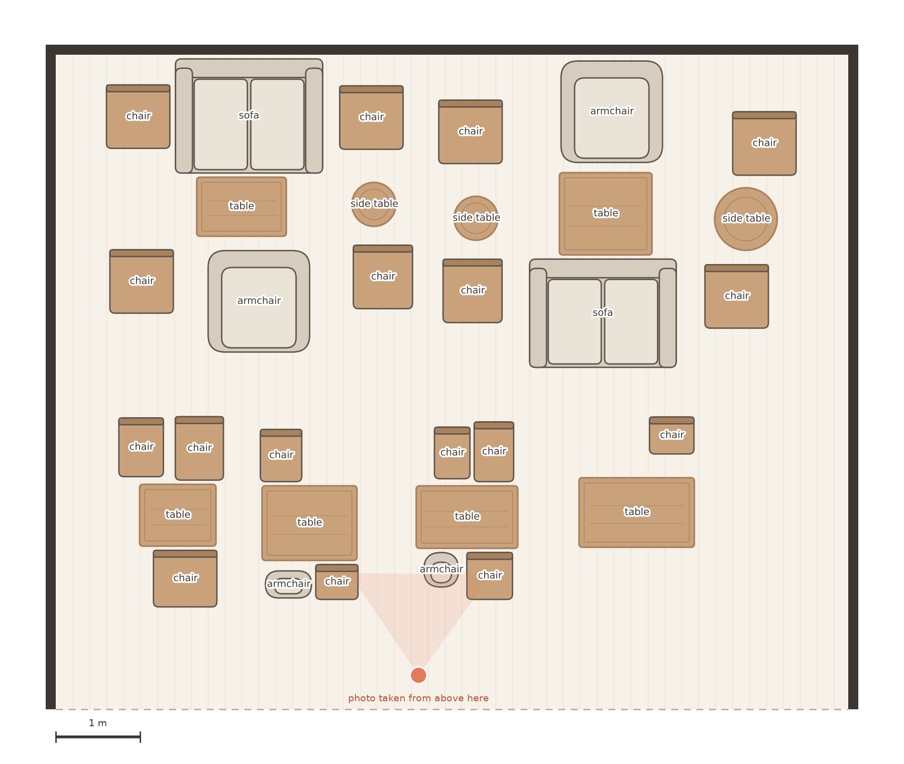
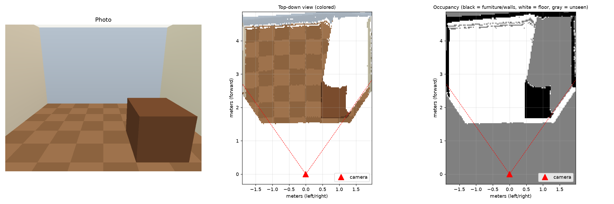
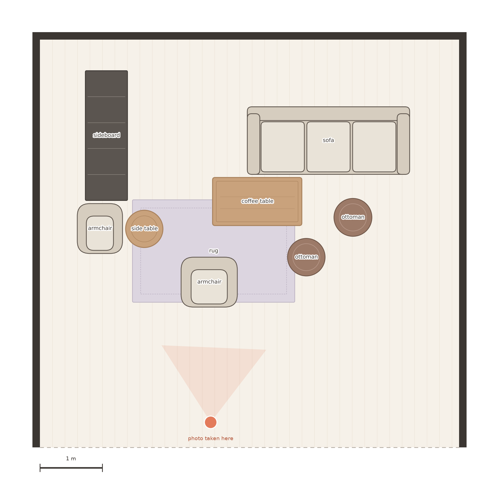

# room-plan-from-photo

Turn a single photo of a room into an illustrated top-down floor plan. Free and runs locally, using open AI models.



## How it works

1. **Find the furniture.** [Grounding DINO](https://huggingface.co/IDEA-Research/grounding-dino-base) detects sofas, chairs, tables, rugs, beds, and other furniture, plus people (who are ignored). [CLIP](https://huggingface.co/openai/clip-vit-base-patch32) double-checks look-alike labels such as chair vs. armchair.
2. **Measure depth.** [Depth Anything V2 (metric, indoor)](https://huggingface.co/depth-anything/Depth-Anything-V2-Metric-Indoor-Large-hf) estimates the distance of every pixel in meters, and the floor plane is found with RANSAC.
3. **Place each piece on the floor.**
   - Eye-level photos: each piece is placed using the 3D points inside its box. Furniture in front is used to work out what's hidden behind it.
   - Photos taken from above (camera tilted down more than 40°): each box is projected straight onto the floor.
4. **Tidy up.** The layout is lined up with the room's main direction, pieces are snapped square and pushed apart so they don't overlap, and the result is drawn with furniture icons, walls, and a 1 m scale bar.

## Setup

Requires Python 3.10+. A CUDA GPU is optional but much faster.

```bash
python -m venv .venv
.venv\Scripts\activate          # Windows  (macOS/Linux: source .venv/bin/activate)
pip install -r requirements.txt
```

For GPU support, install the CUDA build of PyTorch first, as described at [pytorch.org](https://pytorch.org/get-started/locally/).

The first run downloads the models (about 2 GB).

## Usage

```bash
python room_plan.py photo.jpg                 # saves photo_plan.png
python room_plan.py photo.jpg --out plan.svg  # vector output
python room_plan.py photo.jpg --debug         # also saves the detected boxes
```

| Option | What it does |
|---|---|
| `--fov 70` | Camera horizontal field of view in degrees. Use ~65–70 for a phone main camera, ~110 for ultrawide. |
| `--view auto\|eye\|overhead` | Eye-level or from-above photo. `auto` decides from the camera tilt. |
| `--threshold 0.3` | Detection confidence. Lower values find more furniture, along with more false positives. |
| `--model large\|base\|small` | Depth model size. |
| `--no-labels` | Leaves furniture names off the plan. |

### Raw top-down map

`room_topdown.py` is the simpler first version. It projects the depth point cloud straight down and draws a colored bird's-eye view plus an occupancy map, with no furniture recognition.

```bash
python room_topdown.py photo.jpg --ply room.ply
```



`make_test_room.py` renders a synthetic room with known dimensions for testing.

## Examples

| Living room (eye-level) | Café (from above) |
|---|---|
|  |  |

## Limitations

- **One photo, one view.** Walls are drawn where the camera saw them, and furniture backs the camera can't see get typical sizes.
- **Rough sizes.** Expect sizes to be off by roughly 10–20%. They depend on the depth model's scale and on `--fov` matching the camera.
- **Imperfect labels.** Labels can be wrong in cluttered scenes, for example a tub chair drawn as a plain chair.
